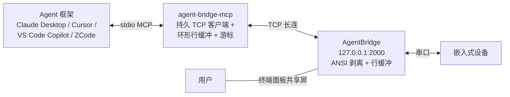
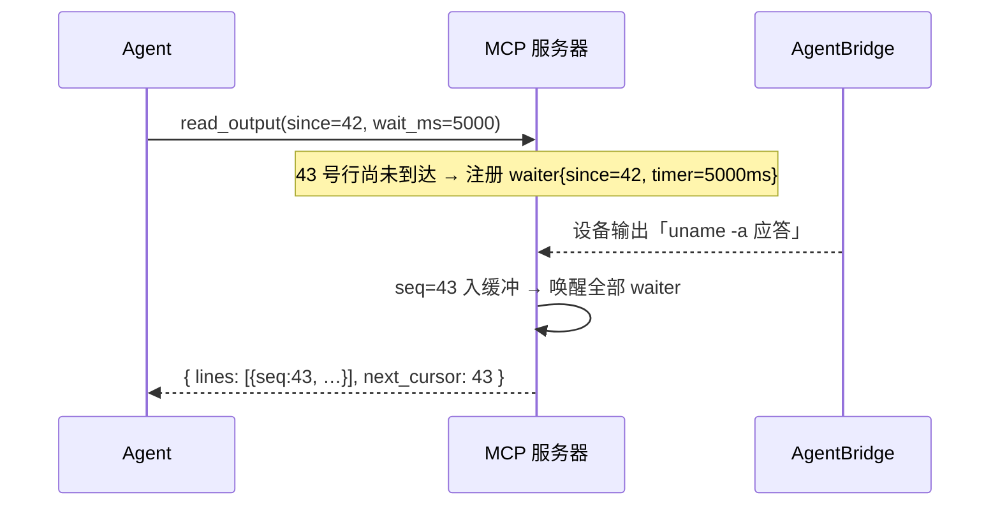
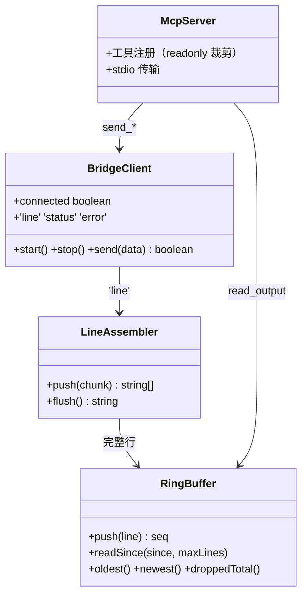

# AgentBridge MCP 服务器设计

> 状态：**设计阶段（未实现）** ｜ 定位：VS Code 扩展 [Serial Port Terminal](https://github.com/ziqiang-zhu/vscode-serial-port-terminal) AgentBridge 的 MCP（Model Context Protocol）服务器伴随包 ｜ 上位文档：[README](../README.md)

## 1. 背景与目标

### 1.1 痛点

AgentBridge 的裸 TCP 形态下，Agent 框架的工具执行普遍是「连接 → 发命令 → 读一小段 → **断开**」：

- 桥契约「无客户端时串口数据丢弃、不做历史补发」（扩展侧 `SerialPortAgentBridge.onData` 首行守卫）——两条命令之间落在「零客户端」窗口的设备输出（应用日志、内核消息）**永久丢失**；
- Agent 只能用「倒计时抓窗口」的方式对赌输出时机——治标且脆。

### 1.2 目标

- **持久订阅者**：本服务器作为桥的长驻 TCP 客户端，从启动到关闭不断线——桥端「零客户端」窗口结构性消失，设备输出 100% 被接住；
- **游标缓冲**：环形行缓冲 + 单调递增游标，Agent 以无状态工具调用按游标补收——不丢、不重、事后可读；
- **标准接入面**：stdio MCP 服务器，Claude Desktop / Cursor / VS Code Copilot（1.99+）/ ZCode 等 MCP 客户端原生消费，工具 schema 自描述——**免装 Skill 即插即用**；
- **一条提示词接入**：用户复制一条提示词给 Agent，Agent 自主完成安装、配置与使用（§6）。

### 1.3 非目标

- 设备枚举 / 连接生命周期（`list_devices` / `connect` / `disconnect`）——桥依附已连接的串口且无控制协议，裸 TCP 形态做不到；归扩展侧「方案 B（扩展内 MCP 端点）」与串口助手 v1.6.0 合并评估；
- 不做 GUI、不做多串口聚合（一次服务一个桥地址）；
- 不改变扩展与桥的任何行为与契约（桥「不做历史补发」契约保留——持久订阅者使该契约的触发条件消失，热路径零改动）。

## 2. 形态与架构

Node.js CLI 包（bin：`agent-bridge-mcp`），stdio 传输的 MCP 服务器（官方 `@modelcontextprotocol/sdk`）。进程由 MCP 宿主（Claude Desktop / Cursor / VS Code / ZCode）拉起并持有，生命周期随宿主会话。



- 用户侧体验不变：照常连接设备、开启桥、在终端面板看到一切（桥多客户端，本服务器与用户终端互不干扰）；
- 上行（`send_line`）经桥 → 串口；下行（设备输出）经桥剥离 ANSI → 本进程行缓冲 → Agent 按游标读取。

## 3. 数据流与缓冲

### 3.1 行组装与空闲刷出

桥下行已剥离 ANSI，但存在「半行刷出」：行缓冲静默 200ms 会把不完整的尾行先推出（典型 = 提示符，如 `root@localhost:~# `）。本进程**再做一次行组装**（按 `\n` 切分，尾段保留等待续行）吸收之——与桥自身的行缓冲同构；对 Agent 无感知：按 seq 连续返回，一行拆两次到达也被组装回完整行。

**空闲刷出（对齐桥的 200ms 语义）**：本进程行组装同样以 200ms 静默把残留半行刷出为独立行。没有这一层，桥空闲刷出的提示符会在 MCP 层被二次缓冲、等一个不会到来的 `\n`——桥侧「消除提示符延迟」的设计意图被二次延迟，Agent 无法及时看到「命令已执行完」的提示符信号。副作用是有意接受的无损拆分：提示符与下一条命令回显分属两行（跨刷出窗口的续行不再拼接）。

### 3.2 环形行缓冲

- 每行一个单调递增 `seq`（进程内计数器，跨上游重连**连续**）；
- 上限默认 **5000 行**（`--max-lines` 可调）；行级丢弃从最旧开始，丢弃发生时记录「已蒸发行数」，读取结果携带 `dropped` 字段**诚实报告**（不静默）；
- 内存上限双保险：累计字节超过 `--max-bytes`（默认 1 MB）同样触发淘汰；
- 上游断开期间缓冲保留、seq 不变；重连后继续累计——但**桥停 / VS Code 关闭期间的输出在本进程缓冲之外**（桥契约所定，见 §11 已知限制）。

### 3.3 上游连接管理

- 启动即连；断线自动重连，指数退避（1s 起、30s 封顶）；
- 桥不可达时**进程保持存活**：工具照常响应——`status` 报告 `connected: false`，`read_output` 返回既有缓冲内容；`send_line` 返回明确错误；
- 上行写失败（连接断开瞬间的写入）即时报错，不假成功；
- 重连退避基数可经构造参数注入（`reconnectBaseMs`，默认 1000ms）——测试注入小值加速重连，生产行为不变。

### 3.4 断线时的半行

上游断开（桥停止 / 连接中断）瞬间，行组装器可能残留未完结的半行。处置：**半行立即刷出为独立行入缓冲**（内容不丢原则——它可能是设备的最后一段输出；完整性无法保证，不做标记，模型侧对无换行结尾文本有容忍度）。重连后行组装**从零开始**、不与断线前半行拼接——两段输出归属模糊，宁可「拆成两行」不可「错拼一行」（与桥自身断开收尾 flush 半行的行为一致）。

### 3.5 长轮询并发机理

`read_output(wait_ms > 0)` 且 `since` 处无新数据时的等待模型：



- 新行入缓冲即唤醒**全部** waiter：各自按自己的 `since` 检查——有新数据立即 resolve；无新数据（`since > newest`，未来游标）继续等待至超时，resolve 空结果 + `next_cursor = newest`；
- 超时定时器独立于唤醒路径，先到先触发；
- `wait_ms` 上限 **30000**（防挂死），超出值静默收敛到上限；`wait_ms = 0`（默认）即时返回不等待；
- 并发多 waiter 天然支持——每次 MCP 调用独立注册，互不影响。

### 3.6 并发与独占（决策：不提供独占机制）

多客户端并存是桥的既有语义（多客户端广播、任意客户端可写），本服务器作为常驻订阅者不改变它，也**刻意不引入独占 / 锁定机制**：

1. **读路径零争用**：桥下行是广播非消费，多订阅者各拿全量流；`read_output` 游标按调用传入，多 Agent 并发补收互不干扰（§8.1 #16）——独占会摧毁「多 Agent 协作 + 与用户共享终端屏」的产品形态；
2. **写路径交错是串口总线的固有属性**，今天已存在于多 TCP 客户端 / 终端面板键入 / 宏发送三条通道之间——桥级独占关不掉其中两条，提供的只是假独占；
3. **无握手协议下的独占只能是钝锁**（先到锁定、后来拒绝）：唯一受益场景（时序敏感操作要「安静线路」）靠约定即可满足（不并发运行两个 Agent），YAGNI；
4. 可见性已有承载：扩展 1.5.14 起状态栏常驻客户端数（`· N`），常驻的本服务器对用户可见；per-client 身份识别 / 按客户端权限 / opt-in 锁定属方案 C（§10 P2）范畴，出现真实场景（如「两个 Agent 必须互盲」）再评估。

附带说明：多 Agent 并存时相互可见对方操作（广播流不区分来源）——共享屏哲学的有意延续，协作场景为特性而非缺陷。

## 4. MCP 工具

| 工具 | 参数 | 返回 | 说明 |
|---|---|---|---|
| `read_output` | `since?`（游标，缺省=从缓冲最旧）、`wait_ms?`（默认 0，长轮询等待新数据的上限）、`max_lines?`（默认 200） | `{ lines: [{ seq, text }], next_cursor, dropped }` | **核心工具**：游标补收 + 长轮询。`wait_ms > 0` 且无新数据时等待至多该时长——「发命令后等输出」的确定性形态，替代倒计时 |
| `send_line` | `text` | `{ ok }` | 追加行尾后发送（默认 `\r`——终端语义回车，嵌入式 shell 通用；`--line-ending lf` 可选） |
| `send_raw` | `hex` | `{ ok }` | 原始字节发送（二进制协议场景） |
| `status` | — | `{ connected, host, port, buffer: { oldest_seq, newest_seq, dropped_total } }` | 健康检查与缓冲状态 |

- **只读模式**：桥的 readonly 是「客户端注入被丢弃」，TCP 客户端**无法探测**（桥无握手协议，已知限制 §11）。提供 `--readonly` CLI 参数供用户声明——声明后 `send_line` / `send_raw` **不注册**；未声明时工具照常注册，readonly 桥上发送的字节被桥静默丢弃（扩展侧既有语义）；
- 工具描述（MCP schema 的 description）写清用法与游标语义——Agent 免 Skill 的自描述即来自这里。

### 4.1 工具 schema 与自描述文案

工具 description 用**英文**（模型上下文主流语言），游标语义写入描述本体。逐工具定稿：

| 工具 | description（草案，实现时可微调措辞） | inputSchema 要点 |
|---|---|---|
| `read_output` | "Read device output lines collected from the serial terminal (ANSI already stripped by the bridge). Pass `since` (a cursor from a previous call) to get only newer lines; omit it to read from the oldest buffered line. Set `wait_ms` to long-poll for new data instead of returning immediately. Each line carries a monotonically increasing `seq` — store the returned `next_cursor` and pass it back as `since` next time to never miss or duplicate output." | `since`: integer ≥ 0；`wait_ms`: integer 0–30000（默认 0，超限静默收敛）；`max_lines`: integer 1–1000（默认 200） |
| `send_line` | "Send one line of text to the device over the serial terminal. A line ending (CR by default, configurable at server start) is appended automatically. Collect the response with `read_output`." | `text`: string（1–4000 字符） |
| `send_raw` | "Send raw bytes (hex-encoded) to the device over the serial terminal. Use for binary protocols." | `hex`: string（偶数长度十六进制） |
| `status` | "Report the connection state to the AgentBridge (host, port, connected) and the line buffer state (oldest/newest seq, total dropped lines)." | 无参数 |

### 4.2 错误响应约定

- **工具级错误走结果通道**（MCP `isError: true` + 人类可读文本），不用协议级错误——参数校验失败、桥未连接时的 `send_line` / `send_raw`（"bridge not connected"）、`hex` 格式非法等均属此类：模型可见、可自行纠正重试；
- 协议级错误（JSON-RPC 层）仅留给 MCP 框架自身（未知方法 / 解析错误），由 SDK 标准处理；
- `wait_ms` / `max_lines` 超限**不报错**——静默收敛到上限（宽容输入原则：模型给的数值偏差不值得一次失败重试）。

## 5. 配置

CLI 参数与环境变量双通道（参数优先）：

| 参数 | 环境变量 | 默认 | 说明 |
|---|---|---|---|
| `--host` | `AGENT_BRIDGE_HOST` | `127.0.0.1` | 桥地址 |
| `--port` | `AGENT_BRIDGE_PORT` | `2000` | 桥端口 |
| `--readonly` | `AGENT_BRIDGE_READONLY` | 关 | 声明只读（不注册 send 类工具） |
| `--max-lines` | — | `5000` | 环形缓冲行数上限 |
| `--max-bytes` | — | `1048576` | 环形缓冲字节上限 |
| `--line-ending` | — | `cr` | `send_line` 追加的行尾（`cr` / `lf` / `crlf` / `none`） |

运行时依赖仅 `@modelcontextprotocol/sdk`（+Node 内置模块）；engines `>=18`。

## 6. 一条提示词接入

设计目标：用户复制一条提示词给 Agent，Agent 自主完成安装、配置与使用。标准提示词（README 发布时按宿主细化 JSON 片段）：

```text
1. 把 MCP 服务器 agent-bridge-mcp 添加到你的 MCP 客户端配置并启动：
   传输方式 stdio，命令 npx -y agent-bridge-mcp --port 2000；
2. 调用 status 工具确认已连接 127.0.0.1:2000；
3. 之后用 read_output 查看设备输出、send_line 发送命令，等待我的进一步指令。
```

- `npx -y` 使 Agent 无需预先全局安装；宿主差异（VS Code 的 `.vscode/mcp.json` / Claude Desktop 的 `claude_desktop_config.json` / Cursor 的 MCP 配置）由 README 提供逐宿主 JSON 片段，提示词第 1 步引导 Agent 按当前宿主自行套用；
- 与扩展 README 中 agent-bridge-skills 提示词的关系：裸 TCP 形态仍走 Skill 提示词；MCP 形态走本提示词。两者并列收录（扩展 README 后续随 P0 更新）。

### 6.1 逐宿主接入片段（README 定稿前的草案）

VS Code（`.vscode/mcp.json`，1.99+）：

```json
{
  "servers": {
    "agent-bridge-mcp": {
      "type": "stdio",
      "command": "npx",
      "args": ["-y", "agent-bridge-mcp", "--port", "2000"]
    }
  }
}
```

Claude Desktop（`claude_desktop_config.json`）：

```json
{
  "mcpServers": {
    "agent-bridge-mcp": {
      "command": "npx",
      "args": ["-y", "agent-bridge-mcp", "--port", "2000"]
    }
  }
}
```

Cursor（MCP 设置 → Add server，表单等价于上）：name `agent-bridge-mcp`、type `stdio`、command `npx -y agent-bridge-mcp --port 2000`。

> **Windows 附加说明**（README 落实）：部分宿主在 Windows 上直接拉起 `npx` 需经 `cmd /c` 包装——`command: "cmd"`、`args: ["cmd", "/c", "npx", "-y", "agent-bridge-mcp", "--port", "2000"]`；README 逐宿主片段各附 Windows 变体。

## 7. 错误处理

| 场景 | 行为 |
|---|---|
| 上游不可达（桥未开 / VS Code 关闭） | 进程存活；`status.connected=false`；`read_output` 返回缓冲内容；`send_line`/`send_raw` 返回明确错误「bridge not connected」；重连循环持续 |
| 上游写入竞态（断开瞬间的发送） | 即时报错，不假成功 |
| 缓冲溢出 | 淘汰最旧行，`read_output` 结果携带 `dropped` 与 `dropped_total` |
| MCP 协议层错误 | 交由 SDK 标准处理（JSON-RPC 错误响应） |

### 7.1 日志策略

- **全部日志走 stderr**——stdio 传输下 stdout 被 MCP 协议独占，任何 stdout 输出都是协议破坏（实现红线）；
- 最小事件集，无日志级别系统（不过度工程）：上游状态转换（connected / reconnecting / closed）、每次重连尝试、缓冲淘汰（首次发生 + 累计计数）、服务器启动（版本 + 生效参数）；
- 统一前缀 `[agent-bridge-mcp]`，一行一事。

## 8. 测试策略

- **单测（纯逻辑）**：行组装、环形缓冲、工具参数校验与 schema；
- **集成（确定性，mock 桥）**：测试内起 `net.Server` 按 LinuxShell 画像语义回发（含 ANSI 与 200ms 刷出形态），覆盖连接全生命周期；
- **真机人工**：扩展测试构建（F5）连 `VCOM-LINUX` 起桥 → 本服务器接入 → `send_line` + `read_output` 全链路；复用 skills 仓的 `echo MARK` 复合命令确定性验证法。

### 8.1 P0 用例清单

| # | 层 | 用例 | 断言要点 |
|---|---|---|---|
| 1 | 单测 | 完整行逐条入缓冲 | 每行独立 seq，文本保真 |
| 2 | 单测 | 半行跨 chunk 续接 | 两段拼回完整行、单 seq |
| 3 | 单测 | 断线 flush 半行 | 残留半行立即成为独立行；重连后不拼接（§3.4） |
| 4 | 单测 | seq 单调连续 | 跨上游重连 seq 不回绕不重复 |
| 5 | 单测 | 行数上限淘汰 | 超 max-lines 从最旧淘汰，dropped 累计 |
| 6 | 单测 | 字节上限淘汰 | 超 max-bytes 同上 |
| 7 | 单测 | 游标边界 | since 早于 oldest → 从 oldest 起始 + dropped>0；since=newest → 空；since>newest → 空 |
| 8 | 单测 | 参数收敛 | wait_ms>30000 → 30000；max_lines>1000 → 1000；不报错 |
| 9 | 单测 | max_lines 截断 | 部分返回，next_cursor=末行 seq，剩余下次续收 |
| 10 | 单测 | readonly 声明 | `--readonly` 时工具表无 send_line/send_raw |
| 11 | 集成 | 启动连接 | status.connected=true、host/port 正确 |
| 12 | 集成 | 桥断开与重连 | status → false、进程存活、mock 桥恢复监听后自动重连 → true |
| 13 | 集成 | 发送链路 | send_line("help") → mock 桥收到 "help\r" |
| 14 | 集成 | 全链路收集 | help 命令经 mock 桥 LinuxShell 语义（回显+应答行）→ read_output 游标收集不丢不重 |
| 15 | 集成 | 长轮询 | wait_ms 内新数据到达即返回；无数据超时空返回 |
| 16 | 集成 | 并发双游标 | 两个 Agent 各自 since 独立补收，互不干扰 |
| 17 | 集成 | 溢出 gap | 灌入超量行 → dropped 报告、oldest 前移 |
| 18 | 集成 | 空闲刷出提示符 | 桥空闲刷出形态的无换行半行（提示符）→ MCP 侧 200ms 空闲刷出为独立行、read_output 可见 |

真机人工（扩展测试构建 F5 + VCOM-LINUX + 真桥）：接入、send_line → read_output 全链路、只读桥上 send 静默丢弃（对照 --readonly 声明）、npx 启动冒烟（bin 可执行 + MCP initialize 握手）。

## 9. 组件接口与仓库结构

### 9.1 核心接口（实现级草图）

```ts
// lineBuffer.ts —— 行组装 + 环形缓冲 + 游标（纯逻辑，零依赖零 I/O）
class LineAssembler {
  push(chunk: string): string[];   // 输入上游 chunk（\n 切分），返回完成的行；尾段保留
  flush(): string | undefined;     // 断线刷出残留半行为独立行（§3.4）
}
class RingBuffer {
  push(line: string): { seq: number; dropped: number };  // dropped = 本次淘汰的行数
  readSince(since: number, maxLines: number): { lines: { seq: number; text: string }[]; dropped: number; oldest: number; newest: number };
  oldest(): number;  newest(): number;  droppedTotal(): number;
}

// bridgeClient.ts —— 持久上游客户端（状态机：connecting / connected / reconnecting）
class BridgeClient extends EventEmitter {
  // 事件：'line'(text)、'status'(connected: boolean)、'error'(err)
  constructor(host: string, port: number);
  start(): void;                    // 启动连接与重连循环（指数退避 1s→30s）
  stop(): void;                     // 停止重连并断开（MCP 服务器收尾）
  send(data: Buffer): boolean;      // 上行；未连接返回 false
  get connected(): boolean;
}

// tools.ts —— 参数校验（宽容输入：超限收敛不报错，§4.2）+ 工具实现
// server.ts —— SDK 装配：注册工具表（readonly 时裁剪 send 类）、stdio 传输、stderr 日志
```

数据通道单向清晰：`BridgeClient 'line' → LineAssembler → RingBuffer →（read 工具）`；上行 `send 工具 → BridgeClient.send`——读写互不经缓冲。



### 9.2 仓库结构与工程配置

```
agent-bridge-mcp/
├── src/
│   ├── server.ts          # MCP 服务器装配与工具注册
│   ├── bridgeClient.ts    # 持久上游客户端（连接/重连/收发）
│   ├── lineBuffer.ts      # 行组装 + 环形缓冲 + 游标（纯逻辑）
│   └── tools.ts           # 工具实现与参数校验
├── test/                  # 单测 + mock 桥集成
├── doc/设计.md
├── README.md              # 用户向：接入文档（逐宿主）+ 一条提示词
├── package.json
├── tsconfig.json          # 产品编译 → dist/
└── tsconfig.test.json     # 测试编译 → out-test/（沿用扩展仓两配置模式）
```

`package.json` 定稿要点：

- `bin`: `{ "agent-bridge-mcp": "dist/server.js" }`；`files`: `["dist", "README.md"]`；
- `engines`: `>=18`；`dependencies`: 仅 `@modelcontextprotocol/sdk`；
- `scripts`: `build`（tsc → dist）+ `test`（编译测试 → `node --test out-test/**/*.test.js`，glob 必需）+ `prepare`（npm 发包前自动 build）；
- TypeScript 用 **^5.x 稳定版**（工具链成熟度优先——刻意不跟扩展仓的 ^7 Go 版 tsc，两仓工具链互不绑定）；
- 测试运行器 `node:test` + `node:assert/strict`（零测试依赖）。

## 10. 演进路线

- **P0（MVP，实施拆分见 §10.1）**：上游连接 + 重连退避、行组装 + 环形缓冲 + 游标、`read_output` / `send_line` / `status` 三工具、`--readonly`、README 接入文档 + 一条提示词、单测 + mock 桥集成；
- **P1**：`send_raw`、`--line-ending`、缓冲统计细化、多宿主 README 完善；npm 首发（`0.1.x` 独立版本，不进扩展版本链）；
- **P2（远期，落扩展侧待办）**：方案 B——缓冲升格为扩展内 Consumer（免疫 Agent 框架启停 stdio 进程），与串口助手 v1.6.0 合并评估；方案 C——桥握手协议（可探测 readonly、设备枚举，NetworkHal 评估遗产可复用）。

### 10.1 P0 实施拆分

| # | 内容 | 落点 | 验收 |
|---|---|---|---|
| 1 | 工程骨架 | package.json / tsconfig ×2 / src 空实现 | `npm run build` 通过；`node dist/server.js` 可启动并在 stderr 输出启动日志 |
| 2 | lineBuffer | LineAssembler + RingBuffer（§9.1 接口） | 单测 #1–#7 绿 |
| 3 | bridgeClient | 连接 / 重连退避 / 收发 + stderr 状态日志 | 单测依赖项就绪；`npm test` 绿 |
| 4 | tools + server | MCP 装配、`read_output` / `send_line` / `status`、参数校验、readonly 裁剪 | 单测 #8–#10 绿 |
| 5 | mock 桥集成 | §8.1 #11–#18 | 集成全绿 |
| 6 | README 接入文档 | 逐宿主片段（§6.1 草案定稿 + Windows 变体）+ 一条提示词 | 与设计 §6 一致 |
| 7 | 真机人工验证 | 扩展测试构建 + VCOM-LINUX + 真桥 | 人工勾选 §8.1 末段四项 |

提交拆分建议（3 个提交）：①#1+#2（骨架 + 纯逻辑缓冲，`feat: add line assembly and ring buffer`）；②#3+#4（上游客户端 + MCP 工具装配，`feat: add bridge client and MCP tools`）；③#5+#6（集成 + README，`test: add mock bridge integration and docs`）。npm `prepare` 钩子与首发归 P1，P0 只需本地 build/test 闭环。

## 11. 已知限制

1. **readonly 不可探测**：桥无握手协议，客户端无法得知桥是否只读——依赖用户 `--readonly` 声明；未声明时 readonly 桥上的发送被静默丢弃（P2 方案 C 可解）；
2. **桥停窗口外无覆盖**：桥停止 / VS Code 关闭期间的设备输出，桥内无人缓冲——本进程缓冲仅覆盖自身存活且桥在线的窗口；
3. **无生命周期工具**：设备枚举 / 连接 / 断开不在能力范围（桥形态限制，P2 方案 B/C 可解）；
4. **半行刷出**：桥 200ms 空闲刷出使行边界偶发拆分——本进程行组装吸收，seq 连续性保证最终完整。
