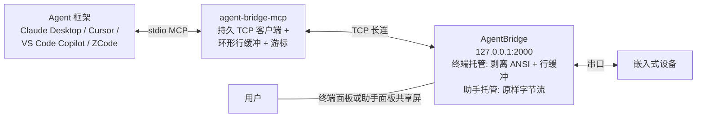
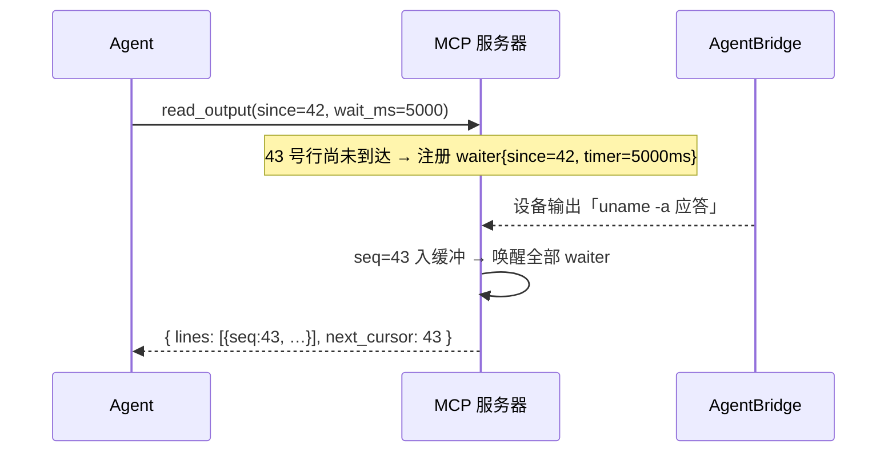
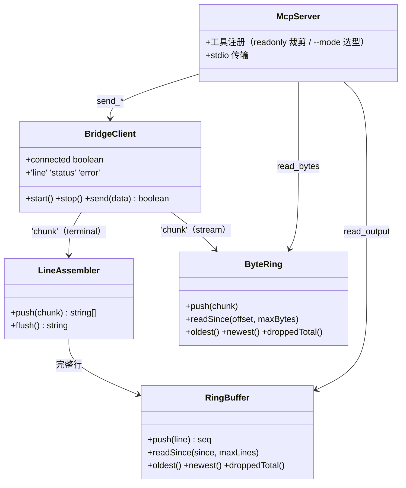

# AgentBridge MCP 服务器设计

> 状态：**设计阶段（未实现）** ｜ 定位：VS Code 扩展 [Serial Port Terminal](https://github.com/ziqiang-zhu/vscode-serial-port-terminal) AgentBridge 的 MCP（Model Context Protocol）服务器伴随包 ｜ 上位文档：[README](../README.md)

## 1. 背景与目标

### 1.1 痛点

AgentBridge 的裸 TCP 形态下，Agent 框架的工具执行普遍是「连接 → 发命令 → 读一小段 → **断开**」：

- 桥契约「无客户端时串口数据丢弃、不做历史补发」（扩展侧 `SerialPortAgentBridge.onData` 首行守卫）——两条命令之间落在「零客户端」窗口的设备输出（应用日志、内核消息）**永久丢失**；
- Agent 只能用「倒计时抓窗口」的方式对赌输出时机——治标且脆。

### 1.2 目标

- **持久订阅者**：本服务器作为桥的长驻 TCP 客户端，从启动到关闭不断线——桥端「零客户端」窗口结构性消失，设备输出 100% 被接住；
- **游标缓冲**：环形行缓冲 + 单调递增游标，Agent 以无状态工具调用按游标补收——不丢、不重、事后可读；
- **两种桥形态对齐（0.2.0）**：终端托管的桥按行输出；串口助手托管的桥是原样字节流。`--mode terminal|stream` 声明桥的托管方，stream 模式提供字节级收发（`read_bytes` / `send_bytes`）——行接口对二进制数据会不可逆损坏（§3.6）；
- **标准接入面**：stdio MCP 服务器，Claude Desktop / Cursor / VS Code Copilot（1.99+）/ ZCode 等 MCP 客户端原生消费，工具 schema 自描述——**免装 Skill 即插即用**；
- **一条提示词接入**：用户复制一条提示词给 Agent，Agent 自主完成安装、配置与使用（§6）。

### 1.3 非目标

- 设备枚举 / 连接生命周期（`list_devices` / `connect` / `disconnect`）——桥依附已连接的串口且无控制协议，裸 TCP 形态做不到；归扩展侧「方案 B（扩展内 MCP 端点）」与串口助手 v1.6.0 合并评估；
- 不做 GUI、不做多串口聚合（一次服务一个桥地址）；
- 不自动探测桥的托管形态（桥无握手协议）——由 `--mode` 显式声明；
- 不改变扩展与桥的任何行为与契约（桥「不做历史补发」契约保留——持久订阅者使该契约的触发条件消失，热路径零改动）。

## 2. 形态与架构

Node.js CLI 包（bin：`agent-bridge-mcp`），stdio 传输的 MCP 服务器（官方 `@modelcontextprotocol/sdk`）。进程由 MCP 宿主（Claude Desktop / Cursor / VS Code / ZCode）拉起并持有，生命周期随宿主会话。



- 用户侧体验不变：照常连接设备、开启桥、在终端/助手面板看到一切（桥多客户端，本服务器与用户面板互不干扰）；
- **桥的两种托管形态**：终端托管（扩展终端开桥）——桥剥离 ANSI 并按行转发，行尾无换行内容 200ms 空闲补发；串口助手托管（助手面板工具栏开桥）——透传模式，原样字节流，不剥离、不按行。桥不携带托管方信息、无法探测，由 `--mode` 声明：`terminal`（默认）注册行工具，`stream` 注册字节工具（§4）；
- 上行（`send_line` / `send_bytes`）经桥 → 串口；下行（设备输出）经桥转发 → 本进程缓冲 → Agent 按游标读取。

## 3. 数据流与缓冲

### 3.1 行组装与空闲刷出

桥下行已剥离 ANSI（**terminal 模式**；stream 模式的桥为透传原样字节，见 §3.6），但存在「半行刷出」：行缓冲静默 200ms 会把不完整的尾行先推出（典型 = 提示符，如 `root@localhost:~# `）。本进程**再做一次行组装**（按 `\n` 切分，尾段保留等待续行）吸收之——与桥自身的行缓冲同构；对 Agent 无感知：按 seq 连续返回，一行拆两次到达也被组装回完整行。

**空闲刷出（对齐桥的 200ms 语义）**：本进程行组装同样以 200ms 静默把残留半行刷出为独立行。没有这一层，桥空闲刷出的提示符会在 MCP 层被二次缓冲、等一个不会到来的 `\n`——桥侧「消除提示符延迟」的设计意图被二次延迟，Agent 无法及时看到「命令已执行完」的提示符信号。副作用是有意接受的无损拆分：提示符与下一条命令回显分属两行（跨刷出窗口的续行不再拼接）。

### 3.2 环形行缓冲

- 每行一个单调递增 `seq`（进程内计数器，跨上游重连**连续**）；
- 上限默认 **1 MB**（`--max-bytes` 可调，utf8 字节计）——**仅字节单上限**（行数不设限：同一批日志的行长差异大，字节才是真实的内存占用度量）；超限从最旧行淘汰，至少保留最新一行（单行超上限时不自我清空）；淘汰发生时记录「已蒸发行数」，读取结果携带 `dropped` 字段**诚实报告**（不静默）；
- **缓冲为纯内存**（进程堆内，无文件落盘）——进程退出即清空，与「重启回归默认」的测试定位一致；
- 上游断开期间缓冲保留、seq 不变；重连后继续累计——但**桥停 / VS Code 关闭期间的输出在本进程缓冲之外**（桥契约所定，见 §11 已知限制）。

### 3.3 上游连接管理

- 启动即连；断线自动重连，指数退避（1s 起、30s 封顶）；
- 桥不可达时**进程保持存活**：工具照常响应——`status` 报告 `connected: false`，`read_output` 返回既有缓冲内容；`send_line` 返回明确错误；
- 上行写失败（连接断开瞬间的写入）即时报错，不假成功；
- 重连退避基数可经构造参数注入（`reconnectBaseMs`，默认 1000ms）——测试注入小值加速重连，生产行为不变；
- **查询即挂接（`connectNow`，2026-11-23 用户定夺「方案 B 含 read_output」）**：`status` / `read_output` 在断开态调用时先取消挂起的退避 timer、立即发起一次真实连接尝试，≤300ms 内等待结果定格后照常应答——桥已上线时 Agent 的第一次工具调用即刻挂接，消除「退避封顶 30s 内桥已可用而实例仍空转」的体感等待。幂等（已连接即返回、在途尝试不重复拨号）；失败**不重置**退避序列（反抖动语义保留，自主循环不受影响）；定格超时（如不可达远端的 SYN 悬挂）则如实报当前状态。这是查询语义的内部增强，不是生命周期工具（§1.3 非目标不变）——目标地址仍由启动参数固化，不存在可参数化的 connect；
- **进程生命周期 = stdio 会话**：stdin 结束（宿主关停）或 SIGINT → `bridge.stop()` → 进程退出。桥在线时的活跃 socket 会挂住 Node 事件循环，缺此关停钩子会滞留为孤儿进程、占用桥客户端位不释放（真机缺陷修复）。

### 3.4 断线时的半行

上游断开（桥停止 / 连接中断）瞬间，行组装器可能残留未完结的半行。处置：**半行立即刷出为独立行入缓冲**（内容不丢原则——它可能是设备的最后一段输出；完整性无法保证，不做标记，模型侧对无换行结尾文本有容忍度）。重连后行组装**从零开始**、不与断线前半行拼接——两段输出归属模糊，宁可「拆成两行」不可「错拼一行」（与桥自身断开收尾 flush 半行的行为一致）。

### 3.5 长轮询并发机理

`read_output(wait_ms > 0)` 且 `since` 处无新数据时的等待模型：



- 新行入缓冲即唤醒**全部** waiter：各自按自己的 `since` 检查——有新数据立即 resolve；无新数据（`since > newest`，未来游标）继续等待至超时，resolve 空结果 + `next_cursor = newest`；
- 超时定时器独立于唤醒路径，先到先触发；
- `wait_ms` 上限 **30000**（防挂死），超出值静默收敛到上限；`wait_ms = 0`（默认）即时返回不等待；
- 并发多 waiter 天然支持——每次 MCP 调用独立注册，互不影响。

### 3.6 字节缓冲（stream 模式）

行接口对二进制数据有四个不可逆破坏点：`TextDecoder` 把非法 UTF-8 字节替换为 U+FFFD、按 `\n` 切分会拆开含 `0x0A` 的帧、行尾 `0x0D` 被吞、无换行数据只能靠 200ms 空闲刷出成「行」。stream 模式改用字节通道：

- **原样入环**：上游 chunk 的 `Buffer` 原样入字节环，不经 TextDecoder、不切行；
- **游标 = 字节偏移**：自连接累计的单调偏移（跨上游重连连续），`read_bytes(since)` 返回 `[since, next_cursor)` 区间的 base64 数据；
- **上限**：同样 `--max-bytes`，与行缓冲各自独立、不共享配额；超限从最旧**整 chunk** 淘汰（不切 chunk），淘汰字节数累计为 `dropped_bytes`——`since` 早于缓冲最旧偏移时，返回从最旧开始并在结果中如实报告缺口；
- **单次返回长度**：受 `max_bytes` 参数约束（默认 4096，上限 65536），超出部分留待下次调用；
- **长轮询**：`wait_ms` 语义与行工具一致——新字节到达即唤醒等待者；
- **两种模式互斥**：字节游标（偏移）与行游标（seq）互不通用，故工具集按模式二选一注册（§4），不存在同一实例同时提供两套游标的形态。

### 3.7 并发与独占（决策：不提供独占机制）

多客户端并存是桥的既有语义（多客户端广播、任意客户端可写），本服务器作为常驻订阅者不改变它，也**刻意不引入独占 / 锁定机制**：

1. **读路径零争用**：桥下行是广播非消费，多订阅者各拿全量流；`read_output` 游标按调用传入，多 Agent 并发补收互不干扰（§8.1 #16）——独占会摧毁「多 Agent 协作 + 与用户共享终端屏」的产品形态；
2. **写路径交错是串口总线的固有属性**，今天已存在于多 TCP 客户端 / 终端面板键入 / 宏发送三条通道之间——桥级独占关不掉其中两条，提供的只是假独占；
3. **无握手协议下的独占只能是钝锁**（先到锁定、后来拒绝）：唯一受益场景（时序敏感操作要「安静线路」）靠约定即可满足（不并发运行两个 Agent），YAGNI；
4. 可见性已有承载：扩展 1.5.14 起状态栏常驻客户端数（`· N`），常驻的本服务器对用户可见；per-client 身份识别 / 按客户端权限 / opt-in 锁定属方案 C（§10 P2）范畴，出现真实场景（如「两个 Agent 必须互盲」）再评估。

附带说明：多 Agent 并存时相互可见对方操作（广播流不区分来源）——共享屏哲学的有意延续，协作场景为特性而非缺陷。

## 4. MCP 工具

| 工具 | 参数 | 返回 | 说明 |
|---|---|---|---|
| `read_output` | `since?`（游标，缺省=从缓冲最旧）、`wait_ms?`（默认 0，长轮询等待新数据的上限）、`max_lines?`（默认 200） | `{ lines: [{ seq, text }], next_cursor, dropped }` | **核心工具（terminal 模式）**：游标补收 + 长轮询。`wait_ms > 0` 且无新数据时等待至多该时长——「发命令后等输出」的确定性形态，替代倒计时。断开态调用先即时挂接（§3.3 connectNow）——桥刚上线时第一次读取即可用 |
| `send_line` | `text` | `{ ok }` | **terminal 模式**：追加 `\r` 后发送（终端语义回车，嵌入式 shell 通用；可配行尾见 §10 P1，未实现） |
| `read_bytes` | `since?`（**字节偏移**游标，缺省=从缓冲最旧）、`wait_ms?`、`max_bytes?`（默认 4096） | `{ data（base64）, next_cursor, dropped_bytes, connected }` | **核心工具（stream 模式）**：按字节读取原始数据，二进制保真（§3.6）；字节游标与行 seq 互不通用 |
| `send_bytes` | `data`（hex 或 base64）、`encoding?`（默认 `hex`） | `{ ok }` | **stream 模式**：发送原始字节、**不追加行尾**；单次 ≤4096 字节；`--readonly` 下不注册 |
| `status` | — | `{ name, version, update_pending, mode, connected, host, port, buffer }` | 设备身份 + 版本与更新感知 + 健康检查与缓冲状态（terminal：`{ oldest_seq, newest_seq, dropped_total }`；stream：`{ oldest_offset, newest_offset, dropped_bytes }`）；断开态调用先即时挂接（§3.3），报回尝试后的真实状态 |

**版本与更新感知（0.2.1）**：`status.version` 为本进程加载的代码版本，供 Agent 对比 GitHub 最新 tag（新版检查由宿主指令规则联网完成，本服务器不做任何网络请求，见 README「保持更新」）；`status.update_pending` 为「磁盘随包 `package.json` 版本高于运行版本」= 已更新未重载（如本机直跑 `git pull` 之后），重载宿主即生效——它不表示上游存在新版本。磁盘版本不可读时不误报（`false`）。

**工具集按模式二选一**：`terminal`（默认）= `read_output` / `send_line` / `status`；`stream` = `read_bytes` / `send_bytes` / `status`。行工具与字节工具不同时注册——两套游标语义不同，同实例并存只会让 Agent 误用。

**设备标识注入（`--name` 必填，用户定夺 2026-11-22）**：上述 description 在注册时以实际设备名插值（如 "…of device 'imx6ull'…"）；`status` 返回携带 `name`；MCP 服务器 initialize 名为 `agent-bridge-mcp (<name>)`——多桥多实例并存时 Agent 在选择工具前即知操作对象（选择阶段消除歧义、防误发）。真身份（串口路径/设备标签/只读状态自动可见）归方案 C 握手，届时 `--name` 退役为可选覆盖。

- **只读模式**：桥的 readonly 是「客户端注入被丢弃」，TCP 客户端**无法探测**（桥无握手协议，已知限制 §11）。提供 `--readonly` CLI 参数供用户声明——声明后 `send_line` / `send_bytes` **不注册**；未声明时工具照常注册，readonly 桥上发送的字节被桥静默丢弃（扩展侧既有语义）；
- 工具描述（MCP schema 的 description）写清用法与游标语义——Agent 免 Skill 的自描述即来自这里。

### 4.1 工具 schema 与自描述文案

工具 description 用**英文**（模型上下文主流语言），游标语义写入描述本体。逐工具定稿：

| 工具 | description（草案，实现时可微调措辞） | inputSchema 要点 |
|---|---|---|
| `read_output` | "Read device output lines collected from the serial terminal (ANSI already stripped by the bridge). When disconnected, the call first attempts to connect to the bridge immediately (bypassing the reconnect backoff). Pass `since` (a cursor from a previous call) to get only newer lines; omit it to read from the oldest buffered line. Set `wait_ms` to long-poll for new data instead of returning immediately. Each line carries a monotonically increasing `seq` — store the returned `next_cursor` and pass it back as `since` next time to never miss or duplicate output." | `since`: integer ≥ 0；`wait_ms`: integer 0–30000（默认 0，超限静默收敛）；`max_lines`: integer 1–1000（默认 200） |
| `send_line` | "Send one line of text to the device over the serial terminal. A CR (carriage return) is appended automatically. Collect the response with `read_output`." | `text`: string（1–4000 字符） |
| `read_bytes` | "Read raw bytes from the serial data stream of the device (pass-through bridge). When disconnected, the call first attempts to connect to the bridge immediately. Pass `since` (a byte-offset cursor from a previous call) to read only newer bytes; omit it to read from the oldest buffered byte. Returns base64-encoded data plus `next_cursor`; store it and pass it back as `since` next time. Set `wait_ms` to long-poll for new bytes. Use this tool for binary protocols; line-based `read_output` is not available in stream mode." | `since`: integer ≥ 0；`wait_ms`: integer 0–30000；`max_bytes`: integer 1–65536（默认 4096） |
| `send_bytes` | "Send raw bytes to the device without any line ending. Encode the payload as hex (default) or base64. Use this tool for binary protocols." | `data`: string（1–8192 字符）；`encoding`: `hex` \| `base64`（默认 `hex`） |
| `status` | "Report the connection state to the AgentBridge (host, port, connected, mode), the running server version and whether an on-disk update waits for a host reload, and the buffer state (line mode: oldest/newest seq and total dropped lines; stream mode: oldest/newest byte offsets and dropped bytes). When disconnected, the call first attempts to connect immediately (bypassing the reconnect backoff) and reports the resulting state." | 无参数 |

### 4.2 错误响应约定

- **工具级错误走结果通道**（MCP `isError: true` + 人类可读文本），不用协议级错误——参数校验失败、桥未连接时的 `send_line` / `send_bytes`（"bridge not connected"）、`send_bytes` 编码格式非法（hex 非偶数长度 / 含非十六进制字符、base64 非法）等均属此类：模型可见、可自行纠正重试；
- 协议级错误（JSON-RPC 层）仅留给 MCP 框架自身（未知方法 / 解析错误），由 SDK 标准处理；
- `wait_ms` / `max_lines` 超限**不报错**——静默收敛到上限（宽容输入原则：模型给的数值偏差不值得一次失败重试）。

## 5. 配置

CLI 参数与环境变量双通道（参数优先）：

| 参数 | 环境变量 | 默认 | 说明 |
|---|---|---|---|
| `--name` | `AGENT_BRIDGE_NAME` | **必填** | 设备标识（缺失启动失败；多桥 + 多 MCP 实例并存时，这是 Agent 选择工具的唯一依据——缺失即产生匿名实例，最坏后果是误发设备） |
| `--host` | `AGENT_BRIDGE_HOST` | `127.0.0.1` | 桥地址 |
| `--port` | `AGENT_BRIDGE_PORT` | `2000` | 桥端口 |
| `--readonly` | `AGENT_BRIDGE_READONLY` | 关 | 声明只读（不注册 send 类工具） |
| `--max-bytes` | — | `1048576` | 缓冲字节上限（terminal 模式按 utf8 字节计行；stream 模式按原始字节计；两者各自独立） |
| `--mode` | `AGENT_BRIDGE_MODE` | `terminal` | 桥托管方：`terminal`（行工具）或 `stream`（字节工具）。须与开桥的扩展形态一致——终端开桥选 terminal，串口助手开桥选 stream；非法值启动即报错退出（与工具层的宽容输入相反） |

运行时依赖仅 `@modelcontextprotocol/sdk`（+Node 内置模块）；engines `>=18`。

## 6. 一条提示词接入

设计目标：用户复制一条提示词给 Agent，Agent 自主完成安装、配置与使用。标准提示词（README 发布时按宿主细化 JSON 片段）：

```text
1. 把 MCP 服务器 agent-bridge-mcp 添加到你的 MCP 客户端配置并启动：
   传输方式 stdio，命令 npx -y github:ziqiang-zhu/agent-bridge-mcp#v0.2.1 --port 2000
   （先问我设备名、日志缓冲大小与桥的托管形态：终端开桥用默认 --mode terminal，
    串口助手开桥加 --mode stream）；
2. 调用 status 工具确认已连接 127.0.0.1:2000；
3. 之后按托管形态使用 read_output / send_line（终端）或 read_bytes / send_bytes（数据流），
   等待我的进一步指令。
```

- `npx -y` 使 Agent 无需预先全局安装；宿主差异（VS Code 的 `.vscode/mcp.json` / Claude Desktop 的 `claude_desktop_config.json` / Cursor 的 MCP 配置）由 README 提供逐宿主 JSON 片段，提示词第 1 步引导 Agent 按当前宿主自行套用；
- 与扩展 README 中 agent-bridge-skills 提示词的关系：裸 TCP 形态仍走 Skill 提示词；MCP 形态走本提示词。两者并列收录（扩展 README 后续随 P0 更新）。

### 6.1 逐宿主接入片段（README 定稿前的草案）

VS Code（`.vscode/mcp.json`，1.99+）：

```json
{
  "servers": {
    "agent-bridge-mcp": {
      "type": "stdio",
      "command": "npx",
      "args": ["-y", "agent-bridge-mcp", "--port", "2000"]
    }
  }
}
```

Claude Desktop（`claude_desktop_config.json`）：

```json
{
  "mcpServers": {
    "agent-bridge-mcp": {
      "command": "npx",
      "args": ["-y", "agent-bridge-mcp", "--port", "2000"]
    }
  }
}
```

Cursor（MCP 设置 → Add server，表单等价于上）：name `agent-bridge-mcp`、type `stdio`、command `npx -y agent-bridge-mcp --port 2000`。

> **Windows 附加说明**（README 落实）：部分宿主在 Windows 上直接拉起 `npx` 需经 `cmd /c` 包装——`command: "cmd"`、`args: ["cmd", "/c", "npx", "-y", "agent-bridge-mcp", "--port", "2000"]`；README 逐宿主片段各附 Windows 变体。

## 7. 错误处理

| 场景 | 行为 |
|---|---|
| 上游不可达（桥未开 / VS Code 关闭） | 进程存活；`status.connected=false`；`read_output` / `read_bytes` 返回缓冲内容；`send_line` / `send_bytes` 返回明确错误「bridge not connected」；重连循环持续 |
| 上游写入竞态（断开瞬间的发送） | 即时报错，不假成功 |
| 缓冲溢出 | 淘汰最旧行，`read_output` 结果携带 `dropped` 与 `dropped_total` |
| MCP 协议层错误 | 交由 SDK 标准处理（JSON-RPC 错误响应） |

### 7.1 日志策略

- **全部日志走 stderr**——stdio 传输下 stdout 被 MCP 协议独占，任何 stdout 输出都是协议破坏（实现红线）；
- 最小事件集，无日志级别系统（不过度工程）：上游状态转换（connected / reconnecting / closed）、每次重连尝试、缓冲淘汰（首次发生 + 累计计数）、服务器启动（版本 + 生效参数）；
- 统一前缀 `[agent-bridge-mcp]`，一行一事。

## 8. 测试策略

- **单测（纯逻辑）**：行组装、环形缓冲、字节环、工具参数校验与 schema；
- **集成（确定性，mock 桥）**：测试内起 `net.Server` 按 LinuxShell 画像语义回发（含 ANSI 与 200ms 刷出形态）或按原样字节回发，覆盖连接全生命周期与两种模式；
- **真机人工**：扩展测试构建（F5）连 `VCOM-LINUX` 起桥 → 本服务器接入 → `send_line` + `read_output` 全链路；复用 skills 仓的 `echo MARK` 复合命令确定性验证法。

### 8.1 P0 用例清单

| # | 层 | 用例 | 断言要点 |
|---|---|---|---|
| 1 | 单测 | 完整行逐条入缓冲 | 每行独立 seq，文本保真 |
| 2 | 单测 | 半行跨 chunk 续接 | 两段拼回完整行、单 seq |
| 3 | 单测 | 断线 flush 半行 | 残留半行立即成为独立行；重连后不拼接（§3.4） |
| 4 | 单测 | seq 单调连续 | 跨上游重连 seq 不回绕不重复 |
| 5 | 单测 | 字节上限淘汰 | 超 max-bytes 从最旧淘汰（10B→13B 触发）、dropped 累计 |
| 6 | 单测 | utf8 记账淘汰 | 多字节字符按 utf8 字节计（`中` = 3B） |
| 7 | 单测 | 游标边界 | since 早于 oldest → 从 oldest 起始 + dropped>0；since=newest → 空；since>newest → 空 |
| 8 | 单测 | 参数收敛 | wait_ms>30000 → 30000；max_lines>1000 → 1000；不报错 |
| 9 | 单测 | max_lines 截断 | 部分返回，next_cursor=末行 seq，剩余下次续收 |
| 10 | 单测 | readonly 声明 | `--readonly` 时工具表无 send 类工具（send_line / send_bytes） |
| 11 | 集成 | 启动连接 | status.connected=true、host/port 正确 |
| 12 | 集成 | 桥断开与重连 | status → false、进程存活、mock 桥恢复监听后自动重连 → true |
| 13 | 集成 | 发送链路 | send_line("help") → mock 桥收到 "help\r" |
| 14 | 集成 | 全链路收集 | help 命令经 mock 桥 LinuxShell 语义（回显+应答行）→ read_output 游标收集不丢不重 |
| 15 | 集成 | 长轮询 | wait_ms 内新数据到达即返回；无数据超时空返回 |
| 16 | 集成 | 并发双游标 | 两个 Agent 各自 since 独立补收，互不干扰 |
| 17 | 集成 | 溢出 gap | 定宽行灌入超量（字节上限 300B）→ dropped=150、保留末 50 行确定 |
| 18 | 集成 | 空闲刷出提示符 | 桥空闲刷出形态的无换行半行（提示符）→ MCP 侧 200ms 空闲刷出为独立行、read_output 可见 |
| 19 | 集成 | 退避中查询即挂接 | 大退避基数（10s）+ 桥下线启动；桥恢复后单次 status / read_output 立即 connected=true（不等退避，§3.3） |
| 20 | 集成 | 连接态查询为 no-op | 已连接时重复 status 不产生第二条 socket（connectionCount 恒 1） |
| 21 | 集成 | 挂接失败不破坏自主循环 | 断开态挂接尝试失败后不再调用工具，桥恢复后退避循环自动重连成功 |

真机人工（扩展测试构建 F5 + VCOM-LINUX + 真桥）：接入、send_line → read_output 全链路、只读桥上 send 静默丢弃（对照 --readonly 声明）、npx 启动冒烟（bin 可执行 + MCP initialize 握手）。

### 8.2 0.2.0 字节能力用例

| # | 层 | 用例 | 断言要点 |
|---|---|---|---|
| 22 | 单测 | 字节环追加与游标 | 连续 chunk 的偏移连续；`readSince(offset, max)` 返回 `[since, next_cursor)` 的 base64、`next_cursor` 正确推进；`since` 缺省从最旧开始 |
| 23 | 单测 | 字节环淘汰与缺口 | 超 `--max-bytes` 从最旧**整 chunk** 淘汰、`dropped_bytes` 累计正确；`since` 早于最旧偏移时返回从最旧开始并报告缺口 |
| 24 | 单测 | 二进制保真 | 含 `0x00` / `0x0A` / `0xFF` 的 payload 往返（读回 base64 解码）与原始字节逐字节一致，无替换、无切分 |
| 25 | 单测 | 模式与只读门禁 | `--mode terminal` 注册 read_output/send_line/status；`--mode stream` 注册 read_bytes/send_bytes/status；两种模式下 `--readonly` 均不注册 send 类工具 |
| 26 | 单测 | send_bytes 编码校验 | hex 奇数长度/非法字符 → `isError`；base64 非法 → `isError`；合法输入 → `ok` 且桥收到精确字节（无附加行尾） |
| 27 | 单测 | 配置解析 | `--mode` 缺省 terminal；非法值 fail-loud 退出；`AGENT_BRIDGE_MODE` 环境变量生效、CLI 优先 |
| 28 | 集成 | 字节端到端 | mock 桥回发含 `0x00`/`0x0A`/`0xFF` 的原始帧 → `read_bytes` 游标收集逐字节保真；`send_bytes` → mock 桥收到精确字节、无 `\r` |
| 29 | 集成 | 字节长轮询 | `wait_ms` 内新字节到达即返回；无数据超时返回空结果 + `next_cursor` 不倒退 |
| 30 | 单测 | 版本与更新感知 | `readDiskVersion` 读临时目录的 package.json、不可读/坏 JSON/缺失返回 undefined；`isUpdatePending` 仅磁盘版本严格更高时为 true（三段式数值比较，`0.10.0` > `0.2.1`）、相等/更低/undefined 为 false；`status` 返回 `version` 与 `update_pending` |

## 9. 组件接口与仓库结构

### 9.1 核心接口（实现级草图）

```ts
// lineBuffer.ts —— 行组装 + 环形缓冲 + 游标（纯逻辑，零依赖零 I/O）
class LineAssembler {
  push(chunk: string): string[];   // 输入上游 chunk（\n 切分），返回完成的行；尾段保留
  flush(): string | undefined;     // 断线刷出残留半行为独立行（§3.4）
}
class RingBuffer {
  push(line: string): { seq: number; dropped: number };  // dropped = 本次淘汰的行数
  readSince(since: number, maxLines: number): { lines: { seq: number; text: string }[]; dropped: number; oldest: number; newest: number };
  oldest(): number;  newest(): number;  droppedTotal(): number;
}

// byteBuffer.ts —— 字节环 + 字节偏移游标（纯逻辑，零依赖零 I/O，stream 模式用）
class ByteRing {
  push(chunk: Buffer): void;   // 原始 chunk 入环（整 chunk 记账）
  readSince(offset: number, maxBytes: number): { data: Buffer; nextCursor: number; droppedBytes: number; oldest: number; newest: number };
  oldest(): number;  newest(): number;  droppedTotal(): number;   // 偏移高水位 = 已接收字节总数
}

// bridgeClient.ts —— 持久上游客户端（状态机：connecting / connected / reconnecting）
class BridgeClient extends EventEmitter {
  // 事件：'chunk'(Buffer，原始字节，两模式都发)、'line'(text，terminal 模式行组装)、'status'(connected: boolean)、'error'(err)
  constructor(host: string, port: number);
  start(): void;                    // 启动连接与重连循环（指数退避 1s→30s）
  stop(): void;                     // 停止重连并断开（MCP 服务器收尾）
  connectNow(): Promise<boolean>;   // 查询即挂接（§3.3）：断开态立即尝试，≤300ms 定格；幂等
  send(data: Buffer): boolean;      // 上行；未连接返回 false
  get connected(): boolean;
}

// tools.ts —— 参数校验（宽容输入：超限收敛不报错，§4.2）+ 工具实现
// server.ts —— SDK 装配：注册工具表（readonly 时裁剪 send 类）、stdio 传输、stderr 日志
```

数据通道单向清晰：`BridgeClient 'chunk' → LineAssembler → RingBuffer →（read_output）`，`BridgeClient 'chunk' → ByteRing →（read_bytes）`；stream 模式只实例化 ByteRing，terminal 模式只实例化 RingBuffer。上行 `send 工具 → BridgeClient.send`——读写互不经缓冲。



### 9.2 仓库结构与工程配置

```
agent-bridge-mcp/
├── src/
│   ├── server.ts          # MCP 服务器装配与工具注册
│   ├── bridgeClient.ts    # 持久上游客户端（连接/重连/收发）
│   ├── lineBuffer.ts      # 行组装 + 环形缓冲 + 游标（纯逻辑）
│   ├── byteBuffer.ts      # 字节环 + 字节偏移游标（纯逻辑，stream 模式）
│   ├── version.ts         # 运行版本常量 + 磁盘版本读取（更新感知）
│   └── tools.ts           # 工具实现与参数校验
├── test/                  # 单测 + mock 桥集成
├── doc/设计.md
├── README.md              # Agent 向操作手册：安装流程（先向用户询问缓冲大小）、工具使用规约、逐宿主片段
├── package.json
├── tsconfig.json          # 产品编译 → dist/
└── tsconfig.test.json     # 测试编译 → out-test/（沿用扩展仓两配置模式）
```

`package.json` 定稿要点：

- `bin`: `{ "agent-bridge-mcp": "dist/server.js" }`；`files`: `["dist", "README.md"]`；
- `engines`: `>=18`；`dependencies`: 仅 `@modelcontextprotocol/sdk`；
- `scripts`: `build`（tsc → dist）+ `test`（编译测试 → `node --test out-test/**/*.test.js`，glob 必需）+ **`prepare`（`npm run build`——git 直连分发的必需品**：`npx github:` 安装时 npm 自动执行 prepare 产出 dist，缺失则装出无产物的空包无法运行；本地 `npm install` 亦触发）；
- TypeScript 用 **^5.x 稳定版**（工具链成熟度优先——刻意不跟扩展仓的 ^7 Go 版 tsc，两仓工具链互不绑定）；
- 测试运行器 `node:test` + `node:assert/strict`（零测试依赖）。

## 10. 演进路线

- **P0（MVP，实施拆分见 §10.1）**：上游连接 + 重连退避、行组装 + 环形缓冲 + 游标、`read_output` / `send_line` / `status` 三工具、`--readonly`、README 接入文档 + 一条提示词、单测 + mock 桥集成；
- **0.2.0（字节能力，本批实施）**：`--mode terminal|stream` 声明桥托管方；stream 模式新增 `read_bytes`（字节偏移游标 + base64）与 `send_bytes`（hex/base64、不追加行尾），工具集按模式二选一；行工具描述修正（`send_line` 固定追加 CR，`--line-ending` 留待 P1）；版本 0.1.1 → 0.2.0；
- **0.2.1（更新感知）**：`status` 增加 `version`（供 Agent 对比 GitHub 最新 tag）与 `update_pending`（磁盘高于运行 = 待重载）；新版检查由宿主指令规则在 Agent 侧联网完成（README「保持更新」），本服务器不联网；版本 0.2.0 → 0.2.1；
- **P1**：`--line-ending`、缓冲统计细化、多宿主 README 完善。**分发 = git 直连**（用户定夺 2026-11-22，不经 npm 发布）：`npx -y github:ziqiang-zhu/agent-bridge-mcp#<tag>`——npm 从 GitHub clone 仓库、自动执行 `prepare`（build）、装依赖、按 `bin` 启动；tag 即版本（真机验证通过后打 tag，版本链独立于扩展仓）；npmjs 公共注册表渠道定夺不采用（git 直连的零账号、tag 可复现、仓库即渠道已覆盖需求）；
- **P2（远期，落扩展侧待办）**：方案 B——缓冲升格为扩展内 Consumer（免疫 Agent 框架启停 stdio 进程），与串口助手 v1.6.0 合并评估；方案 C——桥握手协议（可探测 readonly、设备枚举，NetworkHal 评估遗产可复用）。

### 10.1 P0 实施拆分

| # | 内容 | 落点 | 验收 |
|---|---|---|---|
| 1 | 工程骨架 | package.json / tsconfig ×2 / src 空实现 | `npm run build` 通过；`node dist/server.js` 可启动并在 stderr 输出启动日志 |
| 2 | lineBuffer | LineAssembler + RingBuffer（§9.1 接口） | 单测 #1–#7 绿 |
| 3 | bridgeClient | 连接 / 重连退避 / 收发 + stderr 状态日志 | 单测依赖项就绪；`npm test` 绿 |
| 4 | tools + server | MCP 装配、`read_output` / `send_line` / `status`、参数校验、readonly 裁剪 | 单测 #8–#10 绿 |
| 5 | mock 桥集成 | §8.1 #11–#18 | 集成全绿 |
| 6 | README 接入文档 | 逐宿主片段（§6.1 草案定稿 + Windows 变体）+ 一条提示词 | 与设计 §6 一致 |
| 7 | 真机人工验证 | 扩展测试构建 + VCOM-LINUX + 真桥 | 人工勾选 §8.1 末段四项 |

提交拆分建议（3 个提交）：①#1+#2（骨架 + 纯逻辑缓冲，`feat: add line assembly and ring buffer`）；②#3+#4（上游客户端 + MCP 工具装配，`feat: add bridge client and MCP tools`）；③#5+#6（集成 + README，`test: add mock bridge integration and docs`）。npm `prepare` 钩子与首发归 P1，P0 只需本地 build/test 闭环。

### 10.2 0.2.0 实施拆分（字节能力）

| # | 内容 | 落点 | 验收 |
|---|---|---|---|
| 1 | 配置：`--mode terminal\|stream` + `AGENT_BRIDGE_MODE` | `config.ts` | §8.2 #27 绿；非法值启动报错退出 |
| 2 | 字节环与偏移游标 | `byteBuffer.ts`（新建） | §8.2 #22–#24 绿 |
| 3 | 上游原始 chunk 事件 | `bridgeClient.ts`（`'chunk'` 事件，两模式都发） | 不影响既有行路径；`npm test` 绿 |
| 4 | 工具：`read_bytes` / `send_bytes` + 模式选型 + `send_line` 描述修正 | `tools.ts` | §8.2 #25–#26 绿 |
| 5 | 装配：按模式实例化缓冲、注册工具集、`status` 增 mode 与字节缓冲字段 | `server.ts` | 单实例只出现一套 read/send 工具 |
| 6 | 集成：mock 桥字节模式 | `test/integration/mockBridge.test.ts` | §8.2 #28–#29 绿 |
| 7 | README（Agent 向）：安装第 1 步增「桥托管形态」询问项、`--mode` 参数与工具分组、版本引用切 `#v0.2.0`；版本 0.1.1 → 0.2.0 | `README.md` / `package.json` / `server.ts` | 文档与工具表一致 |

提交拆分建议（2 个提交）：①代码 + 测试（#1–#6，`feat: add byte-level read and send for pass-through bridges`）；②文档与版本（#7，`docs: document the stream mode and bump to 0.2.0`）——或合并为一笔（改动同批交付、版本与代码同步），由用户定夺。

## 11. 已知限制

1. **readonly 不可探测**：桥无握手协议，客户端无法得知桥是否只读——依赖用户 `--readonly` 声明；未声明时 readonly 桥上的发送被静默丢弃（P2 方案 C 可解）；
2. **桥停窗口外无覆盖**：桥停止 / VS Code 关闭期间的设备输出，桥内无人缓冲——本进程缓冲仅覆盖自身存活且桥在线的窗口；挂接前窗口同理（退避等待 / 桥未开时桥零客户端不缓冲）——查询即挂接（§3.3）把它压缩到「桥上线 → Agent 首次工具调用」，不归零（归零需桥侧缓冲，P2 方案 B/C）；
3. **无生命周期工具**：设备枚举 / 连接 / 断开不在能力范围（桥形态限制，P2 方案 B/C 可解）；
4. **半行刷出**：桥 200ms 空闲刷出使行边界偶发拆分——本进程行组装吸收，seq 连续性保证最终完整（terminal 模式）；
5. **terminal 模式字节不保真**：终端托管的桥上游已剥 ANSI 并按行缓冲，二进制数据不可恢复——需要字节能力时用串口助手开桥并声明 `--mode stream`；
6. **模式声明靠用户**：桥无握手，`--mode` 写错时表现是「工具能调但数据不符合预期」（如 stream 模式接在终端桥上拿到的是已剥 ANSI 的行流）——README 安装流程要求先问清桥的托管方；
7. **不联网、不自动更新**：本服务器不做网络请求，也不自替换/自重启（stdio 生命周期归宿主）；`update_pending` 仅表示「磁盘已更新、待重载」，上游是否有新版本由 Agent 按宿主指令规则联网检查。
