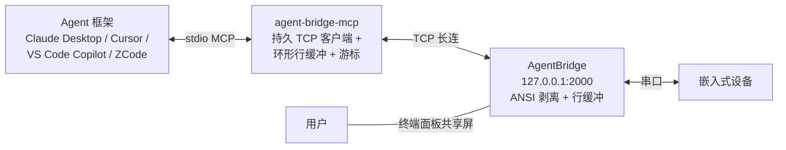

# AgentBridge MCP 服务器设计

> 状态：**设计阶段（未实现）** ｜ 定位：VS Code 扩展 [Serial Port Terminal](https://github.com/ziqiang-zhu/vscode-serial-port-terminal) AgentBridge 的 MCP（Model Context Protocol）服务器伴随包 ｜ 上位文档：[README](../README.md)

## 1. 背景与目标

### 1.1 痛点

AgentBridge 的裸 TCP 形态下，Agent 框架的工具执行普遍是「连接 → 发命令 → 读一小段 → **断开**」：

- 桥契约「无客户端时串口数据丢弃、不做历史补发」（扩展侧 `SerialPortAgentBridge.onData` 首行守卫）——两条命令之间落在「零客户端」窗口的设备输出（应用日志、内核消息）**永久丢失**；
- Agent 只能用「倒计时抓窗口」的方式对赌输出时机——治标且脆。

### 1.2 目标

- **持久订阅者**：本服务器作为桥的长驻 TCP 客户端，从启动到关闭不断线——桥端「零客户端」窗口结构性消失，设备输出 100% 被接住；
- **游标缓冲**：环形行缓冲 + 单调递增游标，Agent 以无状态工具调用按游标补收——不丢、不重、事后可读；
- **标准接入面**：stdio MCP 服务器，Claude Desktop / Cursor / VS Code Copilot（1.99+）/ ZCode 等 MCP 客户端原生消费，工具 schema 自描述——**免装 Skill 即插即用**；
- **一条提示词接入**：用户复制一条提示词给 Agent，Agent 自主完成安装、配置与使用（§6）。

### 1.3 非目标

- 设备枚举 / 连接生命周期（`list_devices` / `connect` / `disconnect`）——桥依附已连接的串口且无控制协议，裸 TCP 形态做不到；归扩展侧「方案 B（扩展内 MCP 端点）」与串口助手 v1.6.0 合并评估；
- 不做 GUI、不做多串口聚合（一次服务一个桥地址）；
- 不改变扩展与桥的任何行为与契约（桥「不做历史补发」契约保留——持久订阅者使该契约的触发条件消失，热路径零改动）。

## 2. 形态与架构

Node.js CLI 包（bin：`agent-bridge-mcp`），stdio 传输的 MCP 服务器（官方 `@modelcontextprotocol/sdk`）。进程由 MCP 宿主（Claude Desktop / Cursor / VS Code / ZCode）拉起并持有，生命周期随宿主会话。



- 用户侧体验不变：照常连接设备、开启桥、在终端面板看到一切（桥多客户端，本服务器与用户终端互不干扰）；
- 上行（`send_line`）经桥 → 串口；下行（设备输出）经桥剥离 ANSI → 本进程行缓冲 → Agent 按游标读取。

## 3. 数据流与缓冲

### 3.1 行组装

桥下行已剥离 ANSI，但存在「半行刷出」：行缓冲静默 200ms 会把不完整的尾行先推出。本进程**再做一次行组装**（按 `\n` 切分，尾段保留等待续行）吸收之——与桥自身的行缓冲同构。对 Agent 无感知：按 seq 连续返回，一行拆两次到达也被组装回完整行。

### 3.2 环形行缓冲

- 每行一个单调递增 `seq`（进程内计数器，跨上游重连**连续**）；
- 上限默认 **5000 行**（`--max-lines` 可调）；行级丢弃从最旧开始，丢弃发生时记录「已蒸发行数」，读取结果携带 `dropped` 字段**诚实报告**（不静默）；
- 内存上限双保险：累计字节超过 `--max-bytes`（默认 1 MB）同样触发淘汰；
- 上游断开期间缓冲保留、seq 不变；重连后继续累计——但**桥停 / VS Code 关闭期间的输出在本进程缓冲之外**（桥契约所定，见 §11 已知限制）。

### 3.3 上游连接管理

- 启动即连；断线自动重连，指数退避（1s 起、30s 封顶）；
- 桥不可达时**进程保持存活**：工具照常响应——`status` 报告 `connected: false`，`read_output` 返回既有缓冲内容；`send_line` 返回明确错误；
- 上行写失败（连接断开瞬间的写入）即时报错，不假成功。

## 4. MCP 工具

| 工具 | 参数 | 返回 | 说明 |
|---|---|---|---|
| `read_output` | `since?`（游标，缺省=从缓冲最旧）、`wait_ms?`（默认 0，长轮询等待新数据的上限）、`max_lines?`（默认 200） | `{ lines: [{ seq, text }], next_cursor, dropped }` | **核心工具**：游标补收 + 长轮询。`wait_ms > 0` 且无新数据时等待至多该时长——「发命令后等输出」的确定性形态，替代倒计时 |
| `send_line` | `text` | `{ ok }` | 追加行尾后发送（默认 `\r`——终端语义回车，嵌入式 shell 通用；`--line-ending lf` 可选） |
| `send_raw` | `hex` | `{ ok }` | 原始字节发送（二进制协议场景） |
| `status` | — | `{ connected, host, port, buffer: { oldest_seq, newest_seq, dropped_total } }` | 健康检查与缓冲状态 |

- **只读模式**：桥的 readonly 是「客户端注入被丢弃」，TCP 客户端**无法探测**（桥无握手协议，已知限制 §11）。提供 `--readonly` CLI 参数供用户声明——声明后 `send_line` / `send_raw` **不注册**；未声明时工具照常注册，readonly 桥上发送的字节被桥静默丢弃（扩展侧既有语义）；
- 工具描述（MCP schema 的 description）写清用法与游标语义——Agent 免 Skill 的自描述即来自这里。

## 5. 配置

CLI 参数与环境变量双通道（参数优先）：

| 参数 | 环境变量 | 默认 | 说明 |
|---|---|---|---|
| `--host` | `AGENT_BRIDGE_HOST` | `127.0.0.1` | 桥地址 |
| `--port` | `AGENT_BRIDGE_PORT` | `2000` | 桥端口 |
| `--readonly` | `AGENT_BRIDGE_READONLY` | 关 | 声明只读（不注册 send 类工具） |
| `--max-lines` | — | `5000` | 环形缓冲行数上限 |
| `--max-bytes` | — | `1048576` | 环形缓冲字节上限 |
| `--line-ending` | — | `cr` | `send_line` 追加的行尾（`cr` / `lf` / `crlf` / `none`） |

运行时依赖仅 `@modelcontextprotocol/sdk`（+Node 内置模块）；engines `>=18`。

## 6. 一条提示词接入

设计目标：用户复制一条提示词给 Agent，Agent 自主完成安装、配置与使用。标准提示词（README 发布时按宿主细化 JSON 片段）：

```text
1. 把 MCP 服务器 agent-bridge-mcp 添加到你的 MCP 客户端配置并启动：
   传输方式 stdio，命令 npx -y agent-bridge-mcp --port 2000；
2. 调用 status 工具确认已连接 127.0.0.1:2000；
3. 之后用 read_output 查看设备输出、send_line 发送命令，等待我的进一步指令。
```

- `npx -y` 使 Agent 无需预先全局安装；宿主差异（VS Code 的 `.vscode/mcp.json` / Claude Desktop 的 `claude_desktop_config.json` / Cursor 的 MCP 配置）由 README 提供逐宿主 JSON 片段，提示词第 1 步引导 Agent 按当前宿主自行套用；
- 与扩展 README 中 agent-bridge-skills 提示词的关系：裸 TCP 形态仍走 Skill 提示词；MCP 形态走本提示词。两者并列收录（扩展 README 后续随 P0 更新）。

## 7. 错误处理

| 场景 | 行为 |
|---|---|
| 上游不可达（桥未开 / VS Code 关闭） | 进程存活；`status.connected=false`；`read_output` 返回缓冲内容；`send_line`/`send_raw` 返回明确错误「bridge not connected」；重连循环持续 |
| 上游写入竞态（断开瞬间的发送） | 即时报错，不假成功 |
| 缓冲溢出 | 淘汰最旧行，`read_output` 结果携带 `dropped` 与 `dropped_total` |
| MCP 协议层错误 | 交由 SDK 标准处理（JSON-RPC 错误响应） |

## 8. 测试策略

- **单测（纯逻辑）**：行组装（半行续接）、环形缓冲（seq 连续性、淘汰、`dropped` 统计）、工具参数校验与 schema；
- **集成（确定性，mock 桥）**：测试内起 `net.Server` 按 LinuxShell 画像语义回发（含 ANSI 与 200ms 刷出形态），覆盖：连接/断线重连退避、长轮询唤醒、游标补收不丢不重、溢出 gap 报告、readonly 不注册 send、多 Agent 并发游标独立；
- **真机人工**：扩展测试构建（F5）连 `VCOM-LINUX` 起桥 → 本服务器接入 → `send_line` + `read_output` 全链路；复用 skills 仓的 `echo MARK` 复合命令确定性验证法。

## 9. 仓库结构

```
agent-bridge-mcp/
├── src/
│   ├── server.ts          # MCP 服务器装配与工具注册
│   ├── bridgeClient.ts    # 持久上游客户端（连接/重连/收发）
│   ├── lineBuffer.ts      # 行组装 + 环形缓冲 + 游标
│   └── tools.ts           # 工具实现与参数校验
├── test/                  # 单测 + mock 桥集成
├── doc/设计.md
├── README.md              # 用户向：接入文档（逐宿主）+ 一条提示词
├── package.json           # bin / engines >=18 / @modelcontextprotocol/sdk
└── tsconfig.json
```

## 10. 演进路线

- **P0（MVP）**：上游连接 + 重连退避、行组装 + 环形缓冲 + 游标、`read_output` / `send_line` / `status` 三工具、`--readonly`、README 接入文档 + 一条提示词、单测 + mock 桥集成；
- **P1**：`send_raw`、`--line-ending`、缓冲统计细化、多宿主 README 完善；npm 首发（`0.1.x` 独立版本，不进扩展版本链）；
- **P2（远期，落扩展侧待办）**：方案 B——缓冲升格为扩展内 Consumer（免疫 Agent 框架启停 stdio 进程），与串口助手 v1.6.0 合并评估；方案 C——桥握手协议（可探测 readonly、设备枚举，NetworkHal 评估遗产可复用）。

## 11. 已知限制

1. **readonly 不可探测**：桥无握手协议，客户端无法得知桥是否只读——依赖用户 `--readonly` 声明；未声明时 readonly 桥上的发送被静默丢弃（P2 方案 C 可解）；
2. **桥停窗口外无覆盖**：桥停止 / VS Code 关闭期间的设备输出，桥内无人缓冲——本进程缓冲仅覆盖自身存活且桥在线的窗口；
3. **无生命周期工具**：设备枚举 / 连接 / 断开不在能力范围（桥形态限制，P2 方案 B/C 可解）；
4. **半行刷出**：桥 200ms 空闲刷出使行边界偶发拆分——本进程行组装吸收，seq 连续性保证最终完整。
